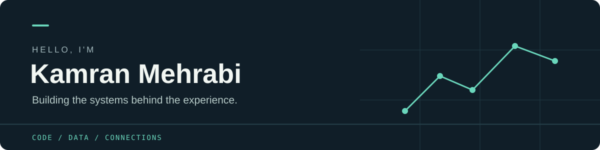

  

Hey, I'm Kamran — a backend developer who enjoys turning complicated requirements into systems that make sense (and occasionally convincing a queue to behave).

I like working on APIs, automation, and the infrastructure that holds everything together. Give me a tricky integration or a mystery bug and I'll probably be curious enough to follow it all the way down.

### Things I like working on

- **Backend systems:** APIs, service architecture, and the logic behind the interface.
- **Automation:** making repetitive work someone else's problem. Preferably a computer's.
- **Data and messaging:** databases, queues, and all the conversations happening between services.
- **Infrastructure:** getting things built, deployed, and running reliably.

### My toolkit

| | |
| :--- | :--- |
| **Languages** | TypeScript · JavaScript · Python |
| **Backend** | Bun · Node.js · ElysiaJS · NestJS · Express · FastAPI |
| **Data** | PostgreSQL · MySQL · MongoDB · Redis · OpenSearch |
| **Messaging & automation** | RabbitMQ · Kafka · Puppeteer |
| **Cloud & delivery** | Docker · AWS · GCP · GitHub Actions · Vercel · Netlify |

### GitHub at a glance

  
  

---

Powered by curiosity, logs, and the occasional “why is this working locally?”
